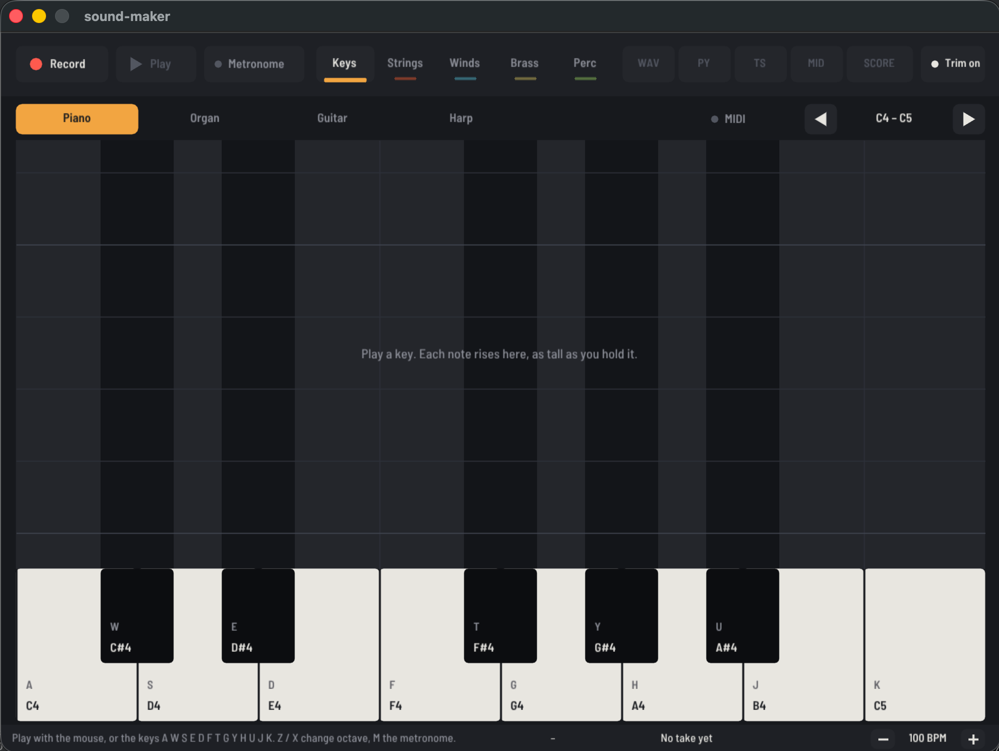

# sound-maker

A small desktop piano for making sounds and short songs for games and other code.
Every note you play rises from its key as a bar, as tall as you held it, in its
instrument family's color (a piano roll).



Play notes with the mouse or keyboard, record them, and then:

- **Save .wav**: a normal audio file, ready to drop into a game's assets.
- **Export .py**: a Python file holding the note list. Run it to rebuild the WAV, edit the notes, or paste them into your own Python code.
- **Export .ts**: a TypeScript module that builds the same sound in memory, with no audio files.
- **Export .mid**: a standard MIDI file for MuseScore, GarageBand, Logic, or a game engine.
- **Sheet music .ly**: a LilyPond score (plain text), engraved as a PDF if LilyPond is installed.

Every sound is made from math in `synth.py`. There are no audio sample files. So what you play, the WAV, and the exported code all sound the same.

```
sound-maker/
  app.py            the window (drawn with DearPyGui): piano roll, instruments, record and export
  synth.py          the instruments and the song renderer (no UI, so other scripts can import it)
  notation.py       MIDI and LilyPond (sheet music) exports (no UI either)
  ts/instruments.ts the same instruments in TypeScript, used by .ts exports
  fonts/            the window's font (Barlow Semi Condensed) and its license (SIL Open Font License)
  test_sound_maker.py  the tests (python -m unittest)
  requirements.txt  the Python packages it needs (numpy, pygame, dearpygui)
  recordings/       where saves and exports go (created on first save, ignored by git)
```

---

## 1. Setup (one time)

Use your own Python from pyenv plus a **virtual environment** (venv), so nothing is installed into the macOS system Python.

> **What a venv is:** a folder (`.venv/`) with its own copy of Python and its own installed packages.
> "Activating" it changes your shell so that `python` and `pip` point into that folder.
> Delete the folder and everything it installed is gone. Nothing else on your machine changes.

```bash
cd ~/dev/sound-maker

# 1. Pick the Python version. The repo includes a .python-version file (3.12.2),
#    and pyenv reads it automatically whenever you're in this folder. Check it:
pyenv version            # -> 3.12.2 (set by .../sound-maker/.python-version)
python --version         # -> Python 3.12.2
#    If that version isn't installed:  pyenv install 3.12.2
#    To change version:                pyenv local 3.13.1   (rewrites .python-version)

# 2. Create the venv. Only needed once. It makes the .venv/ folder.
python -m venv .venv

# 3. Activate it. Do this in every new terminal before working on the project.
source .venv/bin/activate
#    Your prompt now starts with (.venv). Check: `which python` -> .../sound-maker/.venv/bin/python

# 4. Install the packages into the venv
pip install -r requirements.txt
```

**Every time after that:**

```bash
cd ~/dev/sound-maker
source .venv/bin/activate
python app.py
# when you're done, `deactivate` (or just close the terminal)
```

**Python cheat sheet**

| Task | Command |
|---|---|
| Run without activating | `.venv/bin/python app.py` |
| Add a package | `pip install <name>` then `pip freeze > requirements.txt` |
| See installed packages | `pip list` |
| Start the venv over (broken or new Python version) | `rm -rf .venv` then repeat steps 2–4 |
| Self-check the instruments | `python synth.py` (prints each pitch and `ok`) |
| Self-check the MIDI / sheet music exports | `python notation.py` (prints `ok`) |
| Try code interactively | `python` then `>>> import synth` (`exit()` to quit) |

> You don't need tkinter. Your pyenv Pythons weren't built with it. The window is drawn by
> DearPyGui and the sound is played by pygame, both normal pip packages.
> If `pip` says "bad interpreter", the venv was made in a different folder: use `python -m pip`, or start the venv over.

---

## 2. Using the app

```bash
python app.py
```

```
 [Record] [Play] [Metronome]  Keys Strings Winds Brass Perc  WAV PY TS MID SCORE [Trim on]
 [Piano] Organ Guitar Harp                          [MIDI]   <  C4 - C5  >
 ┌──────────────────────────────────────────────────────────────────────────┐
 │  the roll: each note rises from its key as a colored bar, over a beat     │
 │  grid in step with the metronome (a brighter line on every beat 1)        │
 └──────────────────────────────────────────────────────────────────────────┘
 [ piano keys ............................................................. ]
 status message                        C4 0.42 s   Take: 12 notes, 3.4 s   [-] 100 BPM [+]
```

- **Play:** click the keys, or type on the computer keyboard. The key letters are printed on the piano keys:

  ```
     W E   T Y U          C# D#    F# G# A#
    A S D F G H J K      C  D  E  F  G  A  B  C
  ```
- **MIDI keyboard:** plug one in and it's connected when the app starts (the **MIDI** light is on). It plays alongside the computer keyboard and mouse, across its whole range, and records like any other key. Notes outside the 13 keys on screen sound and record but don't draw a bar. Click **MIDI** to disconnect it, or to connect one you plugged in after launch.
- **Octaves:** press **Z** / **X** (or the left / right arrow keys), or click the arrows beside the range (*C4 – C5*), to move the keys down or up an octave (from C1–C2 to C6–C7). The labels on the keys show which octave you're in (C4 is middle C). You can change octave while recording, so one take can cover the whole range.
- **Hold** a key to make the note longer. Releasing it fades the note out over 0.15 s. Struck and plucked instruments (piano, guitar, harp, percussion) die away on their own, like real ones. Blown and bowed ones (woodwinds, brass, strings, organ) keep sounding as long as you hold the key (up to 8 s).
- **Instruments:** click a family tab, then an instrument in the row under it. The up / down arrow keys step through all 21 in order. Each family has its own color, used for its tab, the selected instrument, its bars and the keys it lights:

  | Family | Instruments |
  |---|---|
  | Keys & plucked | Piano, Organ, Guitar (acoustic), Harp |
  | Strings | Violin, Viola, Cello, Double Bass |
  | Woodwinds | Flute, Oboe, Clarinet, Bassoon, Saxophone |
  | Brass | Trumpet, French Horn, Trombone, Tuba |
  | Percussion | Timpani, Snare Drum, Cymbals, Xylophone |

  Switching only changes notes you play after that, so one take can mix instruments. Every key plays every instrument. Use Z / X to move low instruments (tuba, double bass, timpani) into their real range. Snare and cymbals are noise, so the key only changes the drum's thump or how long the crash rings.
- **Record** starts a new take, and **Stop** (the same button, red while recording) ends it. Only notes played between them are saved. If you press Record and then Stop without playing anything, the previous take is kept, so you can back out safely.
- **Play** plays the recording back, and its notes rise through the roll as they sound (only notes inside the octave on screen are drawn).
- **Trim** (on by default) moves the take so the first note starts at 0 s, which removes the silence between pressing Record and playing. Sound effects then start the moment the game calls them. MIDI and SCORE trim differently: they drop only whole bars, so a note you played on beat 2 is still on beat 2 in the score. It changes only playback and exports, never the recording, so you can turn it off and export again with the original timing.
- **WAV / PY / TS / MID / SCORE** write to `recordings/take-<date>-<time>.*` (SCORE writes the `.ly`, plus a PDF when LilyPond is installed). Each one you've saved from the current take gets a check mark until you record a new take. Exports and Play wait until you press Stop.
- **Tempo:** set it with **−** / **+** next to the BPM in the bottom-right corner, or the **[** / **]** keys (5 BPM a step, 40 to 240). The beat grid in the roll follows it. It's locked while recording.
- **Metronome** (or **M**): a click on every beat, higher on beat 1. Its light flashes on each beat. When it's on, Play also clicks along, at the tempo the take was recorded at. The click never goes into an export.
- **Count-in:** pressing Record always plays one bar of clicks first (even with the metronome off), and recording starts on beat 1. Notes you hit up to half a beat early still count, and start at 0 s.
- **The take remembers its tempo.** MIDI and sheet music use the tempo you recorded at, even if you change it afterwards.

The recording is just a list of notes:

```python
(start_seconds, midi_note, held_seconds, instrument)
(0.019, 60, 0.231, 'piano')    # middle C, 0.02 s in, held 0.23 s
```

MIDI note numbers: 60 is middle C, and each +1 is one half step (one piano key, black or white), so 72 is the next C up.
Exports are plain text, so you can clean up timing, change notes, or loop sections by editing the list.

---

## 3. Using the exports

### a) In Python: rebuild the WAV

```bash
source .venv/bin/activate
python recordings/take_20261014_090513.py    # writes take_20261014_090513.wav next to it
```

The exported file imports `synth.py` from the folder above it, so keep it in `recordings/` (or copy `synth.py` next to its parent folder).

### b) In your own Python project

`synth.py` needs only numpy, so you can copy it into any project:

```python
from synth import render, save_wav

MY_JINGLE = [            # pasted from an exported .py
    (0.000, 60, 0.231, "piano"),
    (0.250, 64, 0.231, "piano"),
]

save_wav("jingle.wav", render(MY_JINGLE))
```

Each instrument is a plain `fn(freq, seconds) -> array` at 22050 Hz, so you can also call one directly: `synth.flute(440, 0.5)`.

### c) In TypeScript

1. Copy `ts/instruments.ts` next to the exported `take-....ts`.
2. Use it:

   ```ts
   import { take_20261014_090513Sound } from './take-20261014-090513'
   const bytes: Uint8Array = take_20261014_090513Sound()   // WAV bytes, built in memory
   ```

   Or write notes by hand:

   ```ts
   import { renderWav } from './instruments'
   const ding = renderWav([
     { at: 0,    midi: 72, held: 0.1, instrument: 'piano' },
     { at: 0.12, midi: 79, held: 0.4, instrument: 'piano' },
   ])
   ```

The bytes are a complete 16-bit mono WAV.
In a browser you can play them with `new Audio(URL.createObjectURL(new Blob([bytes], { type: 'audio/wav' }))).play()`.
Recent Node can run `.ts` files directly (`node file.ts`). In that case write the import as `'./instruments.ts'`.

### d) MIDI (`.mid`)

Double-click it to open it in MuseScore (free, [musescore.org](https://musescore.org)), which shows it as sheet music. GarageBand, Logic and most game engines also open it.
The MIDI file keeps your exact timing, so the program you open it in rounds the notes to beats itself. Each instrument gets its own track and its General MIDI sound, and snare and cymbals go on the drum channel. They'll sound like that program's instruments, not like sound-maker's.

### e) Sheet music (`.ly` and `.pdf`)

`.ly` is [LilyPond](https://lilypond.org)'s text format for sheet music. With LilyPond installed (`brew install lilypond`), the button also writes the `.pdf`. Otherwise run `lilypond take-....ly` later.

```lilypond
\new Staff \with { instrumentName = "Cello" } { \time 4/4 \clef "bass"
a4.~ a16 r16 a,2~ |
a,1 |
}
```

`c'` is middle C, `cis` is C#, `'` and `,` move up and down an octave, the number is the length (4 = quarter, 8. = dotted eighth), `~` ties, `r` is a rest, and `|` is a barline. You can fix notes in the text and run `lilypond` again.

How the take becomes notation (in `notation.py`):
- Note starts and lengths snap to the nearest 16th note at the take's tempo, in 4/4 time. Because recording starts on beat 1 after the count-in, the bars line up with what you heard.
- One staff per instrument, in the order they first play, with that instrument's clef. Piano, organ and harp get two staves, and notes move between them automatically.
- Notes that start together become a chord. A note still sounding when the next one starts is cut short, so each staff is one line of music.
- Everything is at concert pitch (clarinet, trumpet, horn and sax parts aren't transposed) and spelled with sharps.

---

## 4. How the sounds are made (for tweaking)

A sound is an array of numbers between -1 and 1, 22050 of them per second (`SR`).
A speaker cone moves out and in following those numbers. A pattern that repeats 440
times a second is heard as the note A.

Each instrument in `synth.py` is a short function, `fn(freq, seconds) -> array`:

| Instrument | Technique | Things to try changing |
|---|---|---|
| piano | adds 7 harmonics (multiples of the note's frequency), with the high ones fading faster | the fade `1.6 + k * 1.4` (smaller = rings longer) |
| guitar | **Karplus-Strong**: a burst of noise that loops and gets smoothed each time round | `0.996` (closer to 1 = sustains longer), the `0.7`/`0.3` mix of triangle shape and noise |
| trumpet | sawtooth harmonics that "open up" over 80 ms, plus vibrato | `brightness` (higher = brassier), vibrato depth `0.006` |
| flute | sine wave plus a little breath noise | `breathiness` |
| organ | fixed sine "drawbars" plus a Leslie wobble | the `drawbars` list |
| harp | the guitar's Karplus-Strong with a softer pluck that rings longer | `loss`, `noise` |
| woodwinds, brass | `_partials()`: a list of harmonic levels, an attack time and vibrato. Clarinet has mostly odd harmonics (hollow), and the low brass have few (round) | the `_harmonics(...)` levels |
| strings | a sawtooth (harmonic k at 1/k), darker and slower to start on the bigger instruments | the power in `k**-1.3`, the attack |
| timpani, xylophone | `_partials()` with non-whole-number overtones (1.5x, 3.93x...) and a `decay` | `decay` (bigger = shorter) |
| snare drum, cymbals | noise with a fast fade. The snare adds a thump at the key's pitch, and the cymbals keep only the high frequencies | the `exp(-t * ...)` fade rates |

Vocabulary:
- **Harmonics:** extra sine waves at 2×, 3×, 4×... the note's frequency. Their mix gives each instrument its *timbre* (its tone color).
- **Envelope:** volume over time. A sharp *attack* sounds plucked or struck, and a slow one sounds blown or bowed.
- **Vibrato:** a small, steady wobble in pitch (about 5 times a second).

**Adding an instrument:** write `def kazoo(freq, seconds): ...` in `synth.py` (often one line using `_partials`) and add it to a family in `FAMILIES`.
It appears in that family's row automatically. A row fits 5 instruments. A new family also needs a color in `FAMILY_COLORS` in `app.py`.
Also give it a General MIDI program and a clef in `MELODIC` in `notation.py`. `python notation.py` fails until you do. To use it from `.ts` exports too, port it into `ts/instruments.ts`.
Run `python synth.py` after any change to check the instruments are still in tune and not too loud, and `python -m unittest` to run all the tests.

**The window:** `app.py` paints the whole window every frame from one state object `s`, like a game loop (`draw()`), and every clickable thing it paints is added to `hits`, so a click just looks up what's under the mouse. Colors and positions are constants at the top of the file (`GROUND`, `FAMILY_COLORS`, `ROLL`, `SPEED`, ...).

**Other knobs:** `DEFAULT_BPM`, `MIN_BPM` / `MAX_BPM` and `BPM_STEP` in `app.py` set the tempo control. `metronome_bar()` in `synth.py` makes the click (change its pitches or length there). `STEPS_PER_BEAT` in `notation.py` sets the grid (4 = 16th notes). `LOW_NOTE` in `app.py` sets the octave the app starts in, and `LOWEST` / `HIGHEST` set how far Z / X can go. `NOTE_GAIN` and `RELEASE` in `synth.py` set the note volume and the fade-out time.

---

## Known limits

- 13 keys are on screen at a time. Use Z / X to reach other octaves.
- Each note can sound for at most 8 s (`MAX_HOLD` in `app.py`).
- The guitar can be up to ~10 cents off pitch on high notes. You'd only notice next to another instrument.
- Sheet music is only as tidy as the playing: triplets and swing don't fit a 16th-note grid, only 4/4 time is supported, and overlapping notes on one instrument get cut short. The WAV, `.py` and `.ts` exports keep the exact timing.
- These are synthesized sounds, not recordings of real instruments. Real-instrument sounds would need SoundFont playback (for example fluidsynth). That's a bigger change, and code exports would no longer match exactly.
